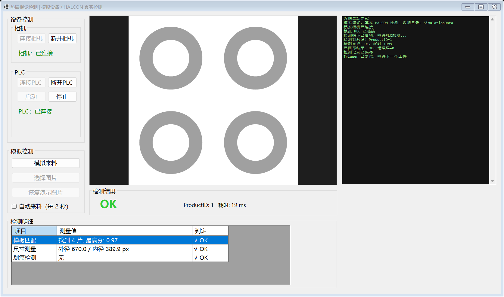
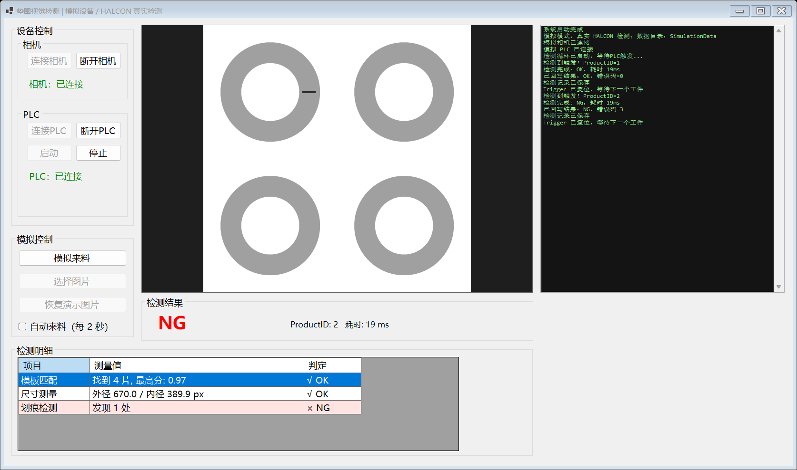
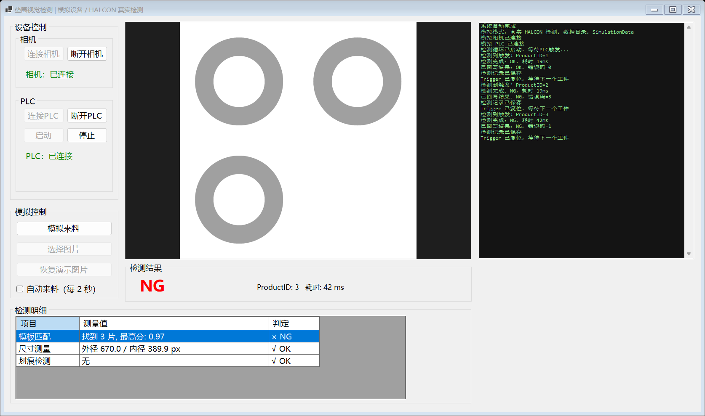

# Inspection Simulation

基于 **C# / .NET 8 / WinForms / HALCON** 的垫圈视觉检测演示项目。通过模拟 PLC 和本地图片相机，在没有真实工业设备的电脑上运行完整检测流程。

**设备是模拟的，视觉检测是真实的。** 模板匹配、尺寸测量和划痕检测均调用本机 HALCON；OK/NG 不是随机数或预设返回值。

## 运行效果

以下截图来自 Windows 上的实际运行。演示图片为程序生成的合成垫圈图，用于复现不同检测结果。

### 合格：四片垫圈

HALCON 匹配到 4 片垫圈，尺寸与表面检查通过；模拟 PLC 收到 OK 和错误码 0。



### 不合格：表面划痕

HALCON 检出 1 处划痕，判定 NG；模拟 PLC 收到错误码 3。



### 不合格：缺少工件

HALCON 只匹配到 3 片垫圈，未达到预期数量 4，判定 NG；模拟 PLC 收到错误码 1。



## 检测流程

```text
手动 / 定时模拟来料
    -> PLC 触发信号与产品编号
    -> 本地图片相机读取下一张图
    -> HALCON 模板匹配 / 尺寸测量 / 划痕检测
    -> 结果与错误码回写模拟 PLC
    -> 保存检测图片和 JSONL 记录
    -> 刷新界面与日志
    -> 触发信号复位，等待下一件
```

- 支持单次来料、每 2 秒自动来料、停止与重新启动。
- 同一件尚未处理完成时拒绝重复触发，自动来料不堆积队列。
- 支持选择一张或多张本地图片，并恢复默认演示样例。
- 图片读取失败按 NG / 99 处理，修复输入后可以继续检测。
- 窗口关闭及设备断开时等待检测结束，避免重叠任务。
- 模拟运行不连接真实 PLC、相机或 SQL Server，也不初始化海康 SDK。

## 环境准备

| 组件 | 要求 |
| --- | --- |
| 操作系统 | Windows x64 |
| IDE / 构建工具 | Visual Studio 2022，安装 .NET 桌面开发工作负载 |
| .NET | 支持构建 net8.0 的 SDK，以及 .NET 8 Windows Desktop 运行时 |
| HALCON | 已安装并具备有效授权，本项目验证版本为 24.11 |
| 海康 MVS SDK | 当前解决方案仍包含硬件适配层，需要其 .NET DLL 完成编译；模拟运行不使用相机 |
| PLC / 相机 / SQL Server | 模拟模式不需要 |

本仓库不分发商业 SDK 二进制或授权文件，需要自行安装。

### SDK 路径

HALCON 安装后应有环境变量 `HALCONROOT`，指向安装目录。程序需要能找到 `bin/x64-win64` 下的运行库，启动脚本会将它加入当前进程的 PATH。

`Directory.Build.props` 优先读取 `HALCONROOT` 与 `MVS_DOTNET_DLL`，并尝试 MVS 的标准安装路径。MVS 安装在其他位置时，在启动用的 PowerShell 中设置：

```powershell
$env:HALCONROOT = 'C:\Program Files\MVTec\HALCON-24.11-Progress-Steady'
$env:MVS_DOTNET_DLL = 'C:\Program Files (x86)\MVS\Development\DotNet\win64\net40\MvCameraControl.Net.dll'
```

请替换为你实际的安装路径。不要将 DLL 或授权文件提交到 Git。

## 快速启动

1. 下载或克隆项目，完成上述环境准备。
2. 双击根目录 **`Start-Simulation.cmd`**，自动构建 Debug/x64 并进入模拟模式。
3. 窗口标题显示“模拟设备 / HALCON 真实检测”，模拟相机和 PLC 自动连接。
4. 点击 **“启动”**，再点击 **“模拟来料”**。默认按“合格、划痕、缺件”循环。
5. 连续演示时勾选 **“自动来料（每 2 秒）”**，结束时点击 **“停止”**。

PowerShell 也可以启动：

```powershell
powershell -NoProfile -ExecutionPolicy Bypass -File .\Start-Simulation.ps1

# 代码未改动且已经构建时，跳过构建：
powershell -NoProfile -ExecutionPolicy Bypass -File .\Start-Simulation.ps1 -NoBuild
```

Visual Studio：打开 `HaspDemo.sln`，将 `HaspDemo.UI` 设为启动项目，选择 **x64** 和 **Simulation** 配置后运行。

> Core 项目包含 COM 引用，直接执行 `dotnet build/run` 会报 MSB4803。请使用启动脚本或 Visual Studio MSBuild。MSB3290 COM 警告不代表构建失败。

### 使用自己的图片

停止检测后，点击“选择图片”加载 PNG、BMP、JPEG 或 TIFF。支持 8 位灰度及 24 位 RGB，彩色图会转成 Mono8 后检测。下次来料开始依次读取所选图片。

自选图片仍沿用当前模板和参数，不会自动建模或标定。不同拍摄尺度、背景和光照可能导致 NG；需要相应调整模板及阈值。点击“恢复演示图片”可以返回默认样例。

## 运行数据

所有模拟数据位于 EXE 旁的 `SimulationData/`，日志位于 `Logs/`：

```text
HaspDemo.UI/bin/x64/Debug/net8.0-windows/
  SimulationData/
    Samples/             # 合格、划痕、缺件演示图片
    washer_model.shm     # 首次启动生成的 HALCON 形状模板
    Images/              # 检测保存图片
    records.jsonl        # 每行一条 JSON 检测记录
  Logs/                  # 运行日志
```

首次启动自动生成演示素材。自动来料会持续保存图片，请留意磁盘空间；这些运行数据不纳入版本管理。

## 项目结构

| 项目 / 目录 | 职责 |
| --- | --- |
| `HaspDemo.Core` | 设备、算法、存储接口和实体 |
| `HaspDemo.Devices` | 海康相机及 S7 PLC 硬件适配器 |
| `HaspDemo.Vision` | HALCON 检测与图像转换 |
| `HaspDemo.Applicationsss` | 轮询、取图、检测、回写、保存、事件通知 |
| `HaspDemo.Persistence` | 文件日志、JSONL 记录、SQL Server 存储实现 |
| `HaspDemo.UI` | WinForms 界面、启动注册、模拟设备与素材生成 |
| `tests/SimulationChecks` | 真实 HALCON 与 WinForms 端到端检查 |

### 模拟参数与错误码

默认演示图尺寸为 1800 x 1800，垫圈外径约 670 px、内径约 390 px，预期数量为 4。模拟配置使用面积范围 200000~260000、匹配分数 0.5 和均值窗口 31；配置位于 `SimulationAssets.CreateInspector()`。

| 错误码 | 含义 |
| --- | --- |
| 0 | 合格 |
| 1 | 模板匹配或工件数量不满足 |
| 2 | 尺寸不满足 |
| 3 | 检出划痕 |
| 9 | 其他检测项不合格 |
| 99 | 取图或算法执行异常 |

## 回归检查

在 Visual Studio Developer PowerShell 中执行：

```powershell
MSBuild .\tests\SimulationChecks\SimulationChecks.csproj /restore /p:Configuration=Debug /p:Platform=x64
$output = Join-Path $env:TEMP ('Inspection-Simulation-' + [guid]::NewGuid())
& .\tests\SimulationChecks\bin\x64\Debug\net8.0-windows\SimulationChecks.exe $output
```

测试输出目录必须尚不存在。检查程序会自动打开并操作窗口，完成后关闭，并将三张运行截图写到输出目录的 `ui/` 下。

检查覆盖真实 HALCON 的 OK/划痕/缺件结果、触发握手、图片及 JSON 保存、坏图 99 与恢复、取消检测、缺模板保护、RGB 转灰度、Bitmap 行对齐、界面启停、自动来料、断开重连、关闭窗口及布局无重叠。

## 硬件模式与边界

不带 `--simulate` 参数运行 EXE，或选择 Visual Studio 的 `Hardware` 配置，会进入硬件模式。运行前需要自行配置 PLC 地址、SQL Server 连接、相机及有效模板；模拟模式不依赖这些设置。

模拟验证不等于真实 S7 网络通信、相机曝光测试、现场精度评估或长时间稳定性测试。合成样例用于学习流程和可重复演示，不应直接作为生产验收依据。
